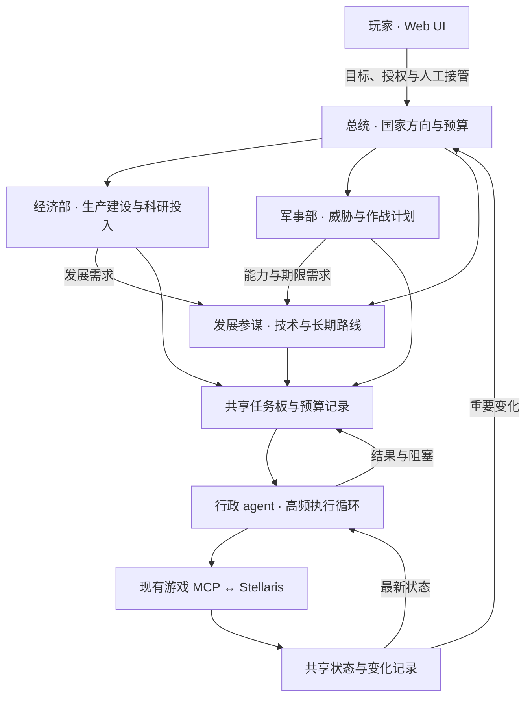
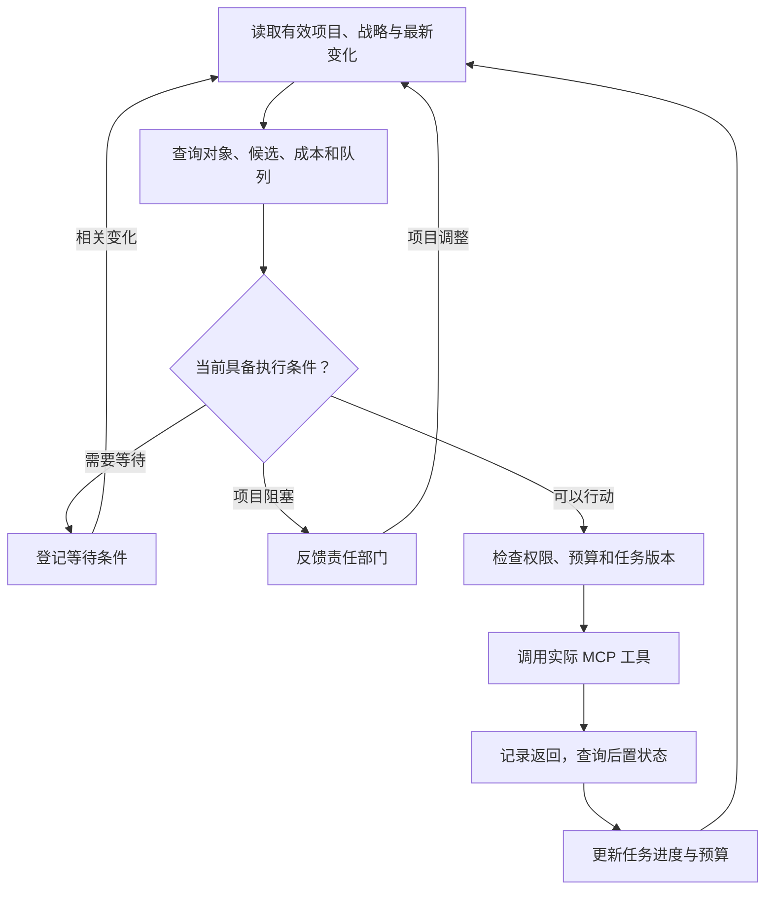

# 群星 AI 接管系统开发计划书

版本 2.1 · 2026-11-11 · 供开发主协调 agent 与开发子 agent 执行

本文按玩家决定重新建立项目。旧 A/B/C 身份、平台结构与模块依赖不再沿用；新仓库以本计划作为起点，旧项目仅作资料归档。现有游戏 MCP 与知识 MCP 继续作为外部依赖使用，经过确认的小段实现可按需移植。本文是开发规格，不表示新项目代码已经实现。

## 1. 产品目标与本次调整

玩家通过电脑或手机的 Web UI 指挥一个外部 AI 政府。总统确定方向，经济部和军事部制定领域计划，发展参谋统筹技术路线，行政 agent 持续读取真实对局并通过现有游戏 MCP 操作。战略规划与行政执行分别运行，支持仅建议、部分接管和全局接管。

玩家已经尝试旧流程，主要阻塞来自底层接口逐条验收，以及依赖原版 AI 内部行为完成具体决策。本次将开发重点放在可观察的真实调用和外部 agent 的持续决策能力上。

| 已确认的安排 | 实施要求 |
|---|---|
| 现有游戏 MCP 承担读取与操作 | 接入玩家实际使用的实例，动态获取工具目录和参数，不为三百多个命令逐条重写业务包装 |
| Debug Web UI 优先交付 | 玩家直接发起调用、查看输出、对照游戏画面、标记差异并导出记录 |
| 接口验证随使用推进 | 工具目录可浏览即可开工，按当前业务需要验证少量调用，发现具体问题后定向修复 |
| 决策与执行分别开发 | 两名负责人分别实现政府规划与行政执行，独立循环并发运行，使用明确的项目与反馈接口协作 |
| 世界知识由独立 MCP 检索 | 使用本地知识库，资料导入与更新通过普通程序完成 |

产品运行依靠结构化数据与 MCP 调用。游戏画面对照用于玩家调试，OCR 不作为运行数据来源。原版 AI 的权重、性格或内部算法不构成本项目规划与执行的依赖。

## 2. 开发 Agent 的新身份

采用 **1 个主协调 + 4 个开发负责人**。废止旧 A/B/C 身份，任务单用下面的名称与标识。四个负责人均拥有可独立交付的产品模块，主协调可依据明确任务临时增加员工。

| 身份 | 任务边界 | 首轮交付 | 主要接口 |
|---|---|---|---|
| COORD · 主协调与集成负责人 | 定义最小契约、拆任务、应用启动和配置、模型调用公共接口、合并与端到端联调 | 新仓库入口、契约 v0、贯穿全流程的同一组样例及联调清单 | 协调公共结构与启动生命周期 |
| GOV · 政府决策负责人 | 总统、经济、军事、发展参谋；规划调度、国家战略、需求与项目生命周期、决策记忆和资料引用 | 输入目标与状态，产生结构化战略和一个可执行项目，接收阻塞反馈并调整 | 读取状态/知识；发布项目；接收执行反馈 |
| EXEC · 行政执行负责人 | 高频行政循环、游戏 MCP 薄客户端、工具发现、动作观察、调用记录、预算预留与权限检查、执行恢复 | 输入样例项目后通过实际 MCP 完成一次授权动作及回读；提供 Web 调试调用入口 | 读取项目/状态；提交受控调用；回写执行反馈 |
| INTEL · 情报与知识负责人 | 当前对局采集、缓存、全局/部门视图、变化事件、时间线；知识 MCP 接入、自动导入、版本与来源 | 一份真实帝国概况及可查询详情，首批机制资料可检索并带来源 | 游戏只读查询、状态查询/订阅、知识查询 |
| WEB · Web 控制台负责人 | 手机控制、Debug 工具台、目标/授权/停止、状态与决策执行展示、问题标记及导出；包含相应 HTTP/事件接口 | 可搜索工具、按 schema 填参数、查看原始输出并标记差异的页面 | 调用 EXEC 的统一入口，查询其他模块，转发玩家控制 |

这里的身份指**开发团队**。产品运行时的总统、经济部、军事部、发展参谋和行政 agent 由 GOV、EXEC 分别实现，其数量与开发人员数量无关。COORD 也不是产品中的总统。

### 2.1 模块边界

- GOV 定义业务目标、约束和优先级；EXEC 决定当前具体操作、等待和回读。GOV 无须为每次点击或下令审批，EXEC 不能自行改写国家战略或扩大权限。
- INTEL 提供当前事实和机制知识，保留来源与时间；跨部门战略取舍由 GOV 决定。
- EXEC 维护资源预留与执行许可的确定性实现；GOV 输出预算意图并读取可用额度。预算、权限和动作记录各只有一个写入责任方。
- WEB 的手动调试也走 EXEC 的统一调用入口。玩家调试授权和政府自主权限分别记录，手动操作后产生变化通知。
- 游戏 MCP 薄客户端由 EXEC 维护，INTEL 复用其只读入口。知识 MCP 客户端由 INTEL 维护。接入只做连接、发现、调用与记录，避免建立三百个业务包装。

### 2.2 并行开工约定

COORD 先与四人确认最小契约及一组可执行样例：状态、项目、调用结果、执行反馈、玩家控制与事件。第一轮只固化当前场景所需字段；契约改动写入决策记录并通知消费者。

GOV 用样例状态开发规划，EXEC 用样例项目开发执行，INTEL 用真实 MCP 输出开发视图，WEB 用相同样例开发界面。样例包含成功、等待、阻塞和错误；接入真实数据后标明其来源，模拟通过仅证明逻辑接线。游戏读写接通后立即逐模块切换真实实现。

首轮并行开发能够解除“等待平台完工”，真实闭环仍需要相关模块接口接通。遇到阻塞必须给出具体缺失方法、字段或复现记录，可继续的工作照常推进。公共契约由 COORD 合并，业务文件各归其 owner，避免多人修改同一实现。

## 3. 总体架构

各部门均从共享状态获取全局摘要、部门变化和按需详情。世界知识 MCP 向各规划角色提供检索。Web UI 查询共享状态、任务、预算和调用记录，并提供玩家的目标输入、授权、调试和停止入口。

初期采用一个本地应用服务，逻辑上划分模块。异步任务分别调度各角色，MCP 连接由共享客户端管理。游戏 MCP、知识 MCP 和本地应用之间使用清楚的连接标识及工具命名空间，避免同名工具混用。首轮以 Windows 上的实际游戏环境为准，模型可在本机或远端运行。

## 4. 运行时政府职责

### 4.1 总统

总统理解玩家的自然语言目标，设定阶段方向、资源底线、部门预算、授权范围和应急预案。总统处理跨部门冲突与重大局势变化，读取全局趋势、部门请求和执行反馈。

输出一份带版本的国家战略，至少包含目标、优先级、预算边界、禁止事项、有效期、预案和重新评估条件。玩家明确指令具有最高优先级。新增游戏写权限由玩家授予。

外交方向、战争意图和全局政策初期由总统统筹，需要时调用专业分析任务。后续依据实际负载再决定是否设独立角色。

### 4.2 经济部

经济部统筹资源收支、人口与岗位、星球生产、建设队列、市场与扩张的经济安排，以及科研设施和科研投入。它负责比较生产、科研和其他建设对共同资源的占用。

经济部向发展参谋提出产业所需能力和科研供给约束，向军事部反馈可负担的建军规模、维护能力与时间。授权预算内的项目可以自行发布，超出预算或损害其他部门已承诺资源时提交协调请求。

### 4.3 军事部

军事部分析可见威胁，规划防御、集结、增援、舰队建设需求和作战行动。提出需要的军事能力与到位期限，交发展参谋安排相关技术路线，交经济部评估生产和维护能力。

军事部按总统授权制定作战项目，行政 agent 落实具体命令。主动宣战、已有战争内行动与防御应急分别表达权限。路径、目标和兵力信息必须来自当前可见对局。

### 4.4 发展参谋

发展参谋直属总统，维护统一的科技、传统和飞升路线。输入包括经济与军事需求、长期科研收益、实际科技候选、前置条件、现有进度及适用版本的机制资料。

科研设施和投入由经济部统筹，技术排序由发展参谋综合决定。发展参谋在给定战略内自主调整候选优先级，重大路线取舍与无法兼顾的需求交总统裁决。

| 事项 | 决策归属 |
|---|---|
| 科研投入与设施建设 | 经济部 |
| 科技、传统、飞升路线 | 发展参谋维护，总统确定重大长期方向 |
| 帝国级政策与跨部门取舍 | 总统，相关部门提供影响分析 |
| 常规领域政策和法令 | 经济部或军事部在授权及预算内决定 |
| 紧急法令与预算切换 | 总统预案定义触发条件，行政层按条件执行 |

### 4.5 行政 agent

行政 agent 读取当前有效项目和预案，按需查询具体对象与合法候选，将任务转为真实 MCP 调用，观察命令结果，维护等待条件、进度与阻塞。

行政 agent 具有局部决策权。例如在已批准技术路线下选择当前合适的研究候选，按建设目标选择符合条件的星球，在防守任务内安排获授权舰队。模型可调用已发现的 MCP 工具完成查询和操作，程序检查模式、权限、预算、对象和任务版本。

第一版采用一个共享行政 agent 与写操作调度器，各部门可同时规划。读取可按工具特性并行，写操作优先按冲突对象和共同资源排序。以后根据实际延迟再拆分行政角色。

## 5. 独立循环与异步协作

至少保证规划与行政两个模型任务能同时推进。总统、各部门和发展参谋可以按各自事件单独唤醒，角色不需要每轮全部开会。

| 循环 | 唤醒条件 | 工作内容 |
|---|---|---|
| 总统 · 低频 | 新玩家目标、重大威胁、跨域冲突、战略到期 | 重评战略和预算，发布新版本 |
| 部门与发展参谋 · 中频 | 领域状态变化、新需求、项目完成或阻塞、定期复评 | 制定、补充或调整项目与路线 |
| 行政 · 高频 | 可行动变化、订单状态变化、失败反馈、待办条件满足 | 查询、操作、回读、等待和反馈 |
| 状态采集 · 持续程序任务 | 轮询周期、查询请求、实际可用的游戏事件 | 更新状态、计算变化、缓存重复读数 |

频率以游戏日期和现实延迟共同配置。首版观察实际游戏速度后确定参数，暂停时重点响应玩家和手动变化。MCP 查询可频繁进行，模型调用由有意义的变化驱动。处理同一个对象的模型推理进行中时，合并后续触发并在返回后判断是否需要重评。

慢速战略推理进行期间，行政层继续执行当前有效计划。新战略发布后，行政层在下一次提交前采用新版本。模型返回时必须检查其输入状态、任务和授权是否仍有效，过期结果进入重新评估。

模型服务需要允许并发请求或使用独立端点，避免单个长推理把行政调用排在后面。限制后台规划并发，为行政请求保留容量。各角色分别配置模型、上下文预算、超时和工具调用上限。

## 6. 共享状态与信息分发

建立一份共享状态，由程序集中采集常用信息。角色读取各自视图，必要时通过查询工具补充详情。跨部门交流主要传递需求、约束和反馈，对局数值统一引用共享状态。

| 信息层 | 内容 | 提供方式 |
|---|---|---|
| 全局摘要 | 游戏日期、战争与风险、关键收支、战略、授权和预算 | 每次角色推理自动带入 |
| 部门摘要与变化 | 本领域队列、瓶颈、需求及相关跨域影响 | 按职责分发，重要变化触发唤醒 |
| 对象与原始详情 | 星球、舰队、科研候选、具体调用输出 | 按需读取，限制返回量，支持分页 |

每条数据保留来源工具、采集时间、游戏日期、会话、时间线和状态版本。不同工具采集时点可能不同，视图应标记数据的新鲜度，无法提供一致快照时明确说明采样范围。未知字段保留 null 及原因。

例如合金短缺先影响经济部。若补舰项目因此延期，军事部同时收到关联项目、缺口和预计影响，需分析原因时再查经济详情。原始变更和程序计算的差异直接记录，重大影响可以唤醒领域模型分析。

读档、切帝国、重开游戏时更新时间线身份，旧对象引用和待提交动作必须重新核对。执行前复查与该动作相关的资源、候选、所有权和队列。

## 7. 共享计划、任务与资源协调

核心对象采用可序列化结构，不依赖模型内部对话记忆。

| 对象 | 必需信息 |
|---|---|
| 国家战略 | strategy_id、revision、目标、约束、预算、预案、有效期 |
| 部门需求 | 请求部门、能力或资源需求、数量或目标、期限、理由、关联项目 |
| 项目 | project_id、版本、所属部门、目标、对象范围、预算、依赖、优先级、完成与终止条件 |
| 行政任务 | task_id、项目版本、当前步骤、具体对象、等待条件、重试记录、执行者 |
| 调用记录 | call_id、trace_id、任务、工具、参数、原始结果、错误、时间、后置观察 |
| 知识引用 | 来源、页面与章节、修订及适用版本、检索时间、引用内容 |

项目描述要足够支持行政层行动。例如科研项目应描述目标能力、候选偏好、投入边界与完成标准，防守项目应描述区域、可用舰队、行动范围及撤离条件。现实参数从对局读取。

预算账本由程序管理，包含已预留、已提交、已观察支出及释放状态。同一笔资源的申请采用原子预留，任务失败、撤销或过期时按实际支出释放余额。资源库存、每月维护能力、队列和舰队占用分别建模。

两部门提出冲突时，授权内可按总统既定优先级与预案仲裁，超出预案才升级给总统。人工接管、授权撤销和紧急停止立即影响可提交范围。

## 8. 行政执行的正常流程

调用接受和游戏目标完成分别表示。科研选择成功与科技研究完成、订单入队与建筑完工、舰队移动提交与到达，均有不同状态和观察条件。对业务当前使用的动作定义最小后置观察规则。

超时或连接断开后，结果未知的写操作先观察实际状态。状态不明时保留 UNKNOWN_RESULT，暂停关联资源的重复支出并反馈。取消命令是否存在、能否生效，由具体工具和当前订单决定。

任务版本变化或人工修改对象时，行政层重新协调后续动作。已进入游戏的操作继续跟踪真实结果，不能通过修改任务板宣称已撤回。

## 9. 现有 MCP 接入范围

开工先读取玩家实际使用的 MCP 配置、工具列表、版本与连接方式。Yidhar/stellaris-mcp 是已发现的原生接口候选，最终采用哪个实例由现有环境决定。目标游戏版本以玩家实际构建、checksum、DLC 与 Mod 清单登记，4.5.3 仅为此前目标基线。

接入模块实现工具发现、参数校验、会话管理、调用超时、错误记录、输出分页与搜索。按领域组织工具索引，角色按需加载工具说明和参数 schema。模型可查询相关工具，避免每次推理带入完整目录。

工具的存在、参数是否兼容、调用能否返回、实际效果是否匹配、当前环境是否允许自动执行分别记录。三百多个命令的目录接入通过工具发现完成，真实功能核对围绕实际任务推进。

| 使用场景 | 开放条件 |
|---|---|
| 查看工具与参数 | 工具发现正常 |
| 玩家主动调试 | 玩家看到工具、参数和已知副作用后主动发起，权限检查生效 |
| agent 只读查询 | 按已登记的只读范围开放，未知副作用工具由 EXEC 根据具体路径分类 |
| agent 自主写入 | 授权内、当前环境可用，已完成该具体业务路径的定向调试与最小观察规则 |
| 联机自主写入 | 该业务路径在联机环境补充定向验证和执行权约束 |

只对正在启用的业务路径做定向核对。工具列表、人工观察范围、当前模式和联机状态在 UI 清楚展示。新路径可先进入玩家调试，已经可用的路径继续开发与运行。

## 10. Debug Web UI 是首个产品交付

### 10.1 工具调试页

- 显示实际 MCP 连接、服务器版本、游戏会话和工具总数，按名称与领域搜索。
- 根据工具 schema 生成参数表单，支持原始 JSON、保存参数模板和重新调用。
- 展示完整输入输出、结构化视图、分页、耗时、错误、调用前后差异。
- 玩家直接标记匹配、不匹配、无法判断、未检查，并记录差异与关联对象。
- 导出一次调用或一个场景的参数、结果、版本和备注，开发 agent 可直接读取复现。
- 记录玩家主动写操作，使政府共享状态和相关任务收到外部变更通知。

页面提供批量整理结果与筛选，批量读取按工具副作用和查询成本控制。批量写入需要玩家明确选择的参数和操作序列。原始输出保存为日志，长文本按需展开，避免所有日志再经模型转述。

### 10.2 政府与执行调试页

同时展示国家战略、部门需求、发展路线、项目、资源预留、角色运行状态和行政当前步骤。每次决策保存输入摘要、资料引用、结构化方案、简短理由、实际工具调用与结果。

提供沿 trace_id 查看一次目标如何变成操作的入口，以及查询失败、数据缺失、知识缺页、决策不合理、参数错误、效果不匹配的分类。玩家可以修改目标、暂停某个部门、接管某个对象或停止全部 AI 新提交。

手机布局支持窄屏操作。本地服务先提供同网络访问和设备配对，远程访问方式根据玩家已有网络环境决定。控制端与浏览器不保存模型密钥。

## 11. 世界知识来源与导入

采用 IbrahimSabriOrene/mcp-stellaris 作为首个本地知识检索实现。它提供 BM25 搜索、页与章节读取、术语表和导入接口。公开仓库初始不带 Wiki 正文，需要准备知识库。

此前已在独立临时环境跑通其自带 smoke test，并验证一篇 Technology 页面经抓取、入库后可以被检索。该记录只证明工具链与单页路径，知识覆盖、资料时效和玩家环境网络访问需要在接手项目中记录。

### 11.1 自动导入流程

从 Stellaris Paradox Wiki 原始 wikitext 获取机制资料，读取项目 data/core_pages.json 的推荐标题。普通 Node 程序复用 fetchRaw() 和 KnowledgeBase.upsertPage()，写入指定的 STELLARIS_KB_DIR。

程序负责限速抓取、重定向、失败重试、断点续传、原始文本校验、入库和检索抽样。网络挑战或失败页面写入待处理清单，避免把错误 HTML 当成机制正文。每页成功后持久化进度，失败页保留重试资格。资料导入直接处理字节，批量过程不需要 LLM。

内置 queue_next 会在取出时移除队列项，批量导入器需独立记录在途与失败状态。数据库和索引更新由一个写入者执行，批量结束后刷新或重启查询服务，避免多进程各持一份旧索引。

### 11.2 知识质量与查询方式

每页导入前保留来源 URL、页面修订、抓取时间、语言、适用版本和内容哈希。转换器会清除 version/sversion 模板，应提前提取并保留原文，无法确定版本时标为未知。

当前搜索分词偏英文。第一版使用英文游戏术语和稳定 key 查询，结果由角色用中文解释，中文别名可以补充映射。科技、建筑和法令的当前可选项、成本与状态优先取实际对局读数，Wiki 用于解释机制、前置关系和路线依据。

第一批资料覆盖当前闭环涉及的研究、资源、生产和建设机制，随后跟随军事与传统业务扩充。常用知识按页面修订缓存，缺页统一加入后台导入清单。不同角色复用检索结果，执行循环继续处理已有明确方案。

实测经验单独记录场景、版本、观察和结论，与 Wiki 机制资料分别标识。攻略中的策略偏好作为可比较建议，机械智能等帝国差异必须进入检索和规划上下文。

## 12. 接管模式与人工控制

| 模式 | 行为 |
|---|---|
| 仅建议 | 各角色可以查询、规划和展示，自动执行入口关闭。玩家可明确批准一个范围有限的一次性项目 |
| 部分接管 | 在指定领域、对象、动作和预算内自主执行 |
| 全局接管 | 在全部已授权且已支持的领域运行，UI 持续显示能力覆盖与待人工事项 |

独立权限检查器位于统一调用入口，覆盖行政、玩家调试和其他写入路径。玩家调试使用明确的调试授权，页面操作不会隐式扩展政府授权。知识 MCP 的导入管理工具单独管理，运行时角色默认查询。

停止、撤权和切模式必须让待提交旧动作失效，不能等待总统推理结束。已提交游戏操作的后续取消作为独立操作处理。人工接管对象后，相关 AI 任务暂停或重新授权，UI 显示原因。

## 13. 联机安排

联机作为正式目标保留，按已接入业务逐项推进。先让同一套政府与行政闭环在单人工作，再对这些实际使用路径增加双客户端对照。

记录房间、游戏构建、控制者与帝国映射、执行权持有者。针对同一帝国设置唯一逻辑写入者和带代次的执行权，防止服务重连或多个控制端重复执行。需要在哪些电脑安装 MCP、哪一端可以提交命令，根据具体 MCP 的真实同步方式确定。

联机最小实验使用低影响、易观察的操作，记录提交端、其他客户端、持续推进和保存重载后的状态及同步异常。单人已用路径的联机失败只阻塞对应联机能力，问题记录回到 Debug 页及定向修复任务。

同帝国多人协作属于后续扩展。首轮多人目标是每位玩家仅操作自己授权的帝国，手机授权与游戏身份绑定共同生效。

## 14. 开发里程碑

采用结果驱动的阶段门。时间按实际依赖和真实环境再估算，主协调每阶段汇报实际模型调用量、阻塞和剩余任务。

| 阶段 | 并行工作 | 交付与退出条件 |
|---|---|---|
| M0 · 接入与调试 | EXEC 接实际 MCP；WEB 做工具页；INTEL 做最小概况；GOV 用样例开发战略与项目 | 玩家在 Web UI 完成真实读取和一次主动写调用，原始结果与标记可导出 |
| M1 · 状态与知识 | INTEL 做共享视图、变化与知识导入；GOV 对接检索；WEB 展示状态；EXEC 补调用观察 | 共享概况、领域变化和详情能查询，首批知识能检索，重启可恢复 |
| M2 · 双循环闭环 | GOV、EXEC 分别启动规划和行政循环；INTEL 发布变化；WEB 显示运行与反馈 | 规划模型仍在运行时行政仍可完成已授权动作，无重复下令 |
| M3 · 部门政府 | GOV 完善部门与发展参谋；EXEC 完善资源预留；WEB 展示需求/预算/项目；INTEL 完善视图 | 军事与经济需求进入统一发展路线，共同资源被正确预留和仲裁 |
| M4 · 单人部分接管 | 根据真实使用问题完善经济、科研和舰队路径 | 持续推进项目并响应状态变化，撤权、人工接管、结果未知可处理 |
| M5 · 联机闭环 | COORD 组织双端实验；EXEC 做执行权与恢复；INTEL 标记会话；WEB 绑定控制身份；GOV 处理反馈 | 手机发令经部门到行政执行，双方观察一致，断线恢复无重复写入 |
| M6 · 扩展全局覆盖 | 逐步补探索、扩张、传统、政策、法令、外交、领导人和事件 | 各领域的可用操作、自动程度、人工事项和版本限制公开记录 |

M0 到 M2 优先形成可用产品。M1 的知识入库和 M2 的调度骨架可以并行，缺少某类资料时记录限制。M3 在角色全部上线前，M2 已有的总统与行政持续可用。

## 15. 第一条完整业务场景

玩家目标为“优先科研，维持经济底线，保留边境防御能力”。场景中的具体对象、候选、预算和阈值从实际对局产生。

1. 总统设定阶段战略和资源底线，经济部提出科研投入，军事部提出能力需求与期限，发展参谋形成统一研究路线。
2. 行政 agent 查询真实科研候选，按路线选择一项获授权研究，再回读当前研究项确认选择生效。
3. 行政查询相关建设条件，具备条件时在预算内下单，登记订单并等待。条件不足时反馈具体缺口。
4. 建设等待期间继续处理其他可行动任务。新科技完成或候选变化时再做局部选择，重大路线冲突上报发展参谋。
5. 模拟一个较慢的战略重评或使用实际长推理，证明行政仍能继续处理原计划内任务。新版战略提交后按版本切换。
6. 玩家在 Web UI 检查整个链路，标记输出与游戏是否一致。已提交动作和实际完成分别显示。

若当前 MCP 缺建设动作，先用科研选择、已有队列观察和另一条已可用操作验证持续循环，建设明确登记为阻塞项。随后继续补齐该路径。

## 16. 主协调 Agent 的派工规则

你的身份是 COORD。按本计划新建项目，把旧项目保留为归档资料；未经玩家指定具体位置，不删除旧目录。当前任务是开发与集成，产品内政府角色由 GOV 和 EXEC 实现。

### 16.1 第一轮任务单

| 负责人 | 独立任务 | 输入 | 首个验收证据 |
|---|---|---|---|
| COORD | 建立最小应用入口、公共契约和集成场景 | 本计划、实际 MCP 配置与目标环境 | 各模块可加载；共用样例通过；依赖与 owner 明确 |
| GOV | 总统与一个领域规划的最小实现 | 玩家目标、样例状态、知识查询接口 | 生成可落地项目；执行返回缺口后能调整；尚无真实执行时明确标识 |
| EXEC | 游戏 MCP 接入、受控调用、行政任务与后置观察 | MCP 配置、样例项目、许可范围 | 当前业务路径真实调用与回读记录；长规划期间可继续推进行政 |
| INTEL | 最小帝国状态与首批机制资料 | 实际读取输出、知识 MCP、来源资料 | 视图包含来源/时间；缺字段明确；资料可查询并保留适用版本 |
| WEB | Debug 页面与玩家控制 | 工具 schema、样例调用/事件、控制接口 | 玩家自主调用、标记并导出；窄屏可操作；接通后的真实调用可追踪 |

每张任务单必须写明文件范围、输入输出、依赖、首个交付与完成条件。先验收一个业务场景，再增加当前场景需要的字段和动作。主协调负责集成验证；各 owner 负责自身模块的必要检查，不另设长期逐条审核 MCP 的岗位。

### 16.2 协作与扩员

四个负责人直接沟通。接口变更告知上下游并记录，主协调处理无法达成一致的边界与优先级。固定共享样例，消费者不能依赖未承诺的隐含字段。业务状态持久化到存储，开发聊天仅用于协作。

若出现实际积压，可把 INTEL 分为 STATE 与 KNOWLEDGE；也可把 GOV 的经济和军事实现交给临时员工，GOV 保持最终集成责任。仅按明确交付物扩员，空闲时让员工休息，避免持续轮询或重复研究。

主协调每次汇报只写：已完成的可运行行为、证据、具体阻塞、接下来的交付。不得以“全量工具尚未验证”或“平台还不完整”阻塞可独立开发的模块。

## 17. 定向验收与成本控制

测试围绕当前交付和已知风险展开，常规传输、参数与状态机检查由程序运行。游戏画面核对由玩家在 Debug 页完成，agent 消费结构化问题记录。上游有针对性测试可以复用，重复运行需要对应代码变化、构建变化或未解决问题。

| 场景 | 验收重点 |
|---|---|
| 工具接入 | 目录、schema、调用结果与实际 MCP 一致，长输出可取回 |
| 玩家调试 | 参数与输出完整保存，观察范围及差异备注可导出 |
| 独立循环 | 慢规划期间行政继续，模型并发容量允许，旧规划不能覆盖新授权 |
| 科研路线 | 经济和军事需求都进入排序，实际选择来自当前候选 |
| 预算冲突 | 两个项目不能消耗同一笔已预留资源，失败与撤销后余额正确 |
| 等待与反馈 | 等待期间不会重复下同一订单，完成或异常能唤醒对应任务 |
| 停止与人工接管 | 待提交动作及时失效，已进入游戏的命令状态如实显示 |
| 超时与恢复 | 结果未知先观察，重启后能恢复任务并避免盲重试 |
| 知识导入 | 成功、失败、在途可恢复，版本与来源保留，失败页面不入库 |
| 联机 | 对当前业务路径做双端对照，执行权转移无重复提交 |

记录真实/模拟环境、游戏构建、调用参数、结果、玩家观察、代码提交与结论范围。玩家观察通过只覆盖当时对象和参数，不自动扩展为整个工具、所有版本和全部联机情况。

token 成本按角色分别统计输入、输出、调用数、耗时、失败及重试。采用摘要、差异、按需工具与知识缓存。首轮实测“每游戏月成本”和“每完成任务成本”，据此调整唤醒条件与模型，而不是预先猜节省比例。

## 18. 新项目目录与归属

新建独立项目目录，下列结构按单体本地应用组织模块。开发分工不要求部署成独立微服务。

| 路径 | owner | 内容 |
|---|---|---|
| app/ | COORD | 启动、配置、模型客户端、模块装配与生命周期 |
| contracts/ | COORD 汇总各 owner 的变更 | 数据结构、查询/调用协议、事件、共同样例 |
| modules/government/ | GOV | 总统、经济、军事、发展参谋及规划调度 |
| modules/government/plans/ | GOV | 战略、需求、项目及修订生命周期 |
| modules/administration/ | EXEC | 高频循环、动作选择、观察、恢复、反馈 |
| modules/control/ | EXEC | 预算账本、授权、停止、对象占用、联机执行权 |
| integrations/game_mcp/ | EXEC | 游戏 MCP 薄客户端、工具发现、受控调用与调用记录 |
| modules/state/ | INTEL | 采集、缓存、分层视图、变化与时间线 |
| modules/knowledge/ | INTEL | 资料导入、来源版本、查询缓存与缺页任务 |
| integrations/knowledge_mcp/ | INTEL | 知识 MCP 连接与查询/导入接口 |
| modules/webui/ | WEB | 前端及面向界面的 HTTP/事件接口 |
| integration/ | COORD | 派工、接口决定、联调场景与定向问题记录 |

持久化接口由各状态 owner 实现，数据库连接与迁移约定由 COORD 协调。运行数据、知识正文、日志、密钥和玩家存档通过配置定位。战略、项目、预算、任务和未决调用需能重启恢复。

## 19. 从零启动的前五项行动

1. COORD 建立新目录和最小契约，登记实际 MCP 与游戏环境。旧项目归档，不把旧平台作为新项目依赖。
2. 同时派出 GOV、EXEC、INTEL、WEB，使用同一业务场景和同一组样例，各自完成最小可交付实现。
3. EXEC 接真实 MCP 后，INTEL 和 WEB 立即接真实读取与调用；玩家在 Debug 页自行对照游戏并导出具体问题。
4. GOV 输出一个真实项目，EXEC 在授权内操作并回读；规划重评与行政推进同时运行，失败反馈回到 GOV。
5. 补入知识和各部门需求，扩展当前场景；COORD 汇报真实效果、阻塞与 token 成本，再安排下一轮。

第一阶段完成的标志是玩家能看见、能调试、能停止的真实运行闭环。后续围绕实际任务扩展能力。

## 20. 参考实现与来源

以下资料作为复用依据，具体版本和构建在项目开工时锁定。既有测试记录来自 2026-11-10 的源码核对及临时环境实验。

- 游戏 MCP 候选采用现有实例优先，参考 [Yidhar/stellaris-mcp](https://github.com/Yidhar/stellaris-mcp)。
- 分层战略、领域状态压缩与长期上下文参考 [Stellaris Overmind](https://github.com/Dfintz/Stellaris_Overmind)。其已核对的玩家模式以建议为主，AI 模式通过性格与修正影响原生 AI。本项目采用外部行政 agent 直接调用游戏 MCP。
- 本地知识工具参考 [Stellaris Teacher MCP](https://github.com/IbrahimSabriOrene/mcp-stellaris)，此前核对提交为 daf3067081cfaa67c6ee4bafc24b576ec03bcdad。
- 知识导入的实现参考该提交的 [抓取代码](https://github.com/IbrahimSabriOrene/mcp-stellaris/blob/daf3067081cfaa67c6ee4bafc24b576ec03bcdad/lib/live.js)、[知识库代码](https://github.com/IbrahimSabriOrene/mcp-stellaris/blob/daf3067081cfaa67c6ee4bafc24b576ec03bcdad/lib/kb.js) 和 [文本转换代码](https://github.com/IbrahimSabriOrene/mcp-stellaris/blob/daf3067081cfaa67c6ee4bafc24b576ec03bcdad/lib/wikitext.js)。
- 机制资料来源为 [Stellaris Paradox Wiki](https://stellaris.paradoxwikis.com/)，按实际对局版本维护引用和适用性。
